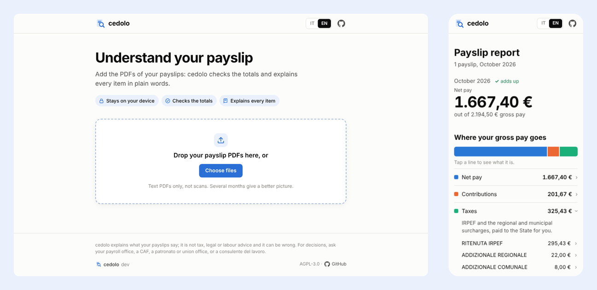

<p align="center">
  
</p>

<h1 align="center">cedolo</h1>

<p align="center">
  <strong>Understand your Italian payslip.</strong><br>
  cedolo reads your PDF payslips (cedolini, buste paga) on your own device,
  checks that the numbers add up and explains every item in plain words.
</p>

<p align="center">
  <a href="https://danielededo.github.io/cedolo/"><strong>Open the web app</strong></a> ·
  <a href="https://github.com/danielededo/cedolo/releases/latest">Download the command-line tool</a> ·
  <a href="#report-a-payslip-read-badly">Report a payslip read badly</a>
</p>

<p align="center">
  <a href="https://github.com/danielededo/cedolo/actions/workflows/ci.yml"></a>
  <a href="https://github.com/danielededo/cedolo/releases/latest"></a>
  <a href="LICENSE"></a>
</p>



## What it does

- **Shows where your gross pay goes**: net pay, contributions, taxes and
  other deductions, one payslip at a time, with every printed item explained
  on tap.
- **Checks the numbers**: every value is marked as verified by the payslip's
  own arithmetic, read, inferred, inconsistent or missing, so a misreading
  shows up instead of hiding behind a plausible number.
- **Explains what changed** from one month to the next, such as surcharge
  instalments, the thirteenth month or the year-end tax adjustment.
- **Follows your pay over time**: where the gross went and what it was made
  of month by month, the totals of each year, the TFR accrued and your
  holiday and leave balances.
- **Identifies your collective agreement (CCNL)** from its CNEL code: sector,
  latest agreement and signatories.
- **Works with any payroll software** that produces text PDFs, without
  templates per vendor. Scanned payslips are not supported yet.
- In **Italian and English**, in the browser or in a terminal.

cedolo explains what a payslip says. It is not tax, legal or labour advice and
it can be wrong; for decisions, ask your payroll office, a CAF, a patronato or
union office, or a consulente del lavoro.

## Privacy

Payslips contain sensitive data, sometimes including health information and
union membership. cedolo reads them **on your device** and sends nothing over
the network. It has no account, no analytics and no telemetry, and the web app
saves nothing: closing the page forgets everything. A Content-Security-Policy
forbids the page from contacting any other site, and browser tests check it.
See [ADR 0003](docs/adr/0003-on-device-processing-by-default.md) and the
[web app's security limits](docs/design/web-security.md).

Never attach a real payslip or a screenshot of one to an issue or pull request.

## Use it

### In the browser

Open **https://danielededo.github.io/cedolo/**, drop the PDFs of your payslips
on the page and read the report. Several months give a better picture.
Payslips protected by a password are opened after you type it; the password
stays in memory only.

The web app is a set of static files, also attached to each release as
`cedolo-web_<version>.zip`. To run your own copy, unpack it, run
`python3 -m http.server --bind 127.0.0.1` in the folder and open
http://127.0.0.1:8000. Browsers do not run it from a file opened directly.

### In a terminal

Download the archive for your system from the
[latest release](https://github.com/danielededo/cedolo/releases/latest),
unpack it and run `cedolo`; nothing else is needed. Check the download against
`SHA256SUMS` if you like. The binaries are not signed: on macOS allow it once
with `xattr -d com.apple.quarantine cedolo`, and on Windows confirm
SmartScreen with "More info", then "Run anyway". With Go installed you can
also run `go run ./cmd/cedolo`.

```
cedolo report -o report.html *.pdf   # the interactive report, offline
cedolo extract payslip.pdf           # items, totals and cross-checks
cedolo compare jan.pdf feb.pdf       # what changed from one month to the next
cedolo glossary conguaglio           # what a payslip word means
cedolo ccnl -search metalmeccanici   # look up a collective agreement
cedolo synth -o synthetic.pdf        # a payslip with invented data, to try it
```

Run `cedolo help` for every command and option. A protected payslip is opened
after cedolo asks for the password in the terminal; scripts can set
`CEDOLO_PDF_PASSWORD`. Files that cannot be read are reported and skipped.

## Report a payslip read badly

cedolo learns new layouts from anonymized copies, never from real payslips.

1. Make an **anonymized copy**: in the web app open "Files", then "Something
   read badly?"; in a terminal run
   `cedolo anonymize -o anonymized.pdf payslip.pdf`. The copy is a new PDF
   rebuilt from the payslip's text with nothing else from the original file.
   Names, companies, addresses, identifiers, dates and codes are masked, and
   so are words that would reveal health, union membership, family situation
   or debts. Amounts are kept so errors in the totals can be reproduced;
   untick the box, or add `-amounts mask`, to mask them too.
2. **Read all of it.** If anything personal survived, do not share it and
   report that instead.
3. Open an issue with the
   [**A payslip is read badly**](https://github.com/danielededo/cedolo/issues/new?template=misread.yml)
   form and attach the copy.

See [CONTRIBUTING.md](CONTRIBUTING.md#reporting-a-payslip-layout) and
[ADR 0008](docs/adr/0008-rebuild-anonymized-payslips.md) for how the copy is
made and what it can still reveal.

## Development

```
go build ./cmd/cedolo
go test ./...
go vet ./...
go run ./cmd/piiscan .
```

Tests that compare against poppler run only when `pdftotext` is installed.
To build and test the web app, with Go and Node.js installed:

```
(cd web && npm ci --omit=optional --ignore-scripts)
go run ./cmd/webbuild -o dist/web
(cd web && npm test)                                              # reads payslips as the CLI does
(cd web && npx playwright install chromium && npm run test:e2e)   # in a real browser
```

See [CONTRIBUTING.md](CONTRIBUTING.md) for the contribution workflow,
[docs/COMMIT-CONVENTION.md](docs/COMMIT-CONVENTION.md) for commit messages,
[docs/design](docs/design) for the design and [docs/adr](docs/adr) for the
decisions behind it.

<details>
<summary>Repository layout</summary>

```
/
├── README.md                 # this file
├── LICENSE                   # GNU AGPL-3.0
├── AGENTS.md                 # instructions for AI coding agents (CLAUDE.md points here)
├── CONTRIBUTING.md           # contribution workflow, sign-off, personal data rules
├── CODE_OF_CONDUCT.md        # Contributor Covenant
├── SECURITY.md               # private vulnerability reporting
├── CHANGELOG.md              # Keep a Changelog, SemVer
├── go.mod, go.sum            # Go module
├── cmd/
│   ├── cedolo/               # the command-line tool
│   ├── piiscan/              # CI check for codici fiscali and IBANs
│   ├── ccnlgen/              # regenerates the CCNL list from the CNEL open data
│   ├── cedolo-wasm/          # the core compiled to WebAssembly for the web app
│   └── webbuild/             # assembles the web app as static files
├── web/                      # the web app: page, pdf.js text layer, tests
├── internal/
│   ├── layout/               # positioned text: the boundary between PDF readers and the core
│   ├── pdftext/              # PDF readers (PDFium in WebAssembly, poppler)
│   ├── money/                # Italian amount parsing, in cents
│   ├── pii/                  # personal identifier detection
│   ├── payslip/              # normalized payslip model
│   ├── taxonomy/             # canonical item catalogue, bilingual labels
│   ├── extract/              # generic extraction and cross-checks
│   ├── anonymize/            # anonymized copies for sharing layouts (ADR 0008)
│   ├── insights/             # month-to-month comparison
│   ├── report/               # self-contained interactive HTML report
│   ├── ccnl/                 # national collective agreements by CNEL code (embedded data)
│   ├── i18n/                 # user-facing texts in Italian and English
│   └── synth/                # synthetic payslips for tests, in several styles
├── docs/
│   ├── design/               # product and architecture design, spike reports
│   ├── images/               # the logo and screenshot of this README
│   ├── adr/                  # architecture decision records
│   ├── BRANCHING-STRATEGY.md
│   ├── COMMIT-CONVENTION.md
│   ├── REPO-SETTINGS.md      # GitHub settings checklist
│   └── AI-AGENTS.md          # how agent instructions and skills are organized
├── .agents/skills/           # agent procedures: new-adr, release
├── .claude/skills/           # symlinks to .agents/skills
└── .github/                  # CI workflow, issue and pull request templates, Dependabot
```

</details>

## Data sources

cedolo embeds the list of national collective agreements in force published
by the CNEL (Consiglio nazionale dell'economia e del lavoro), Archivio
nazionale dei contratti e degli accordi collettivi di lavoro, as open data
under the [Italian Open Data License v2.0](https://www.dati.gov.it/iodl/2.0/).
The list is in `internal/ccnl/ccnl.tsv`, with the date of the export it was
built from; see [ADR 0007](docs/adr/0007-embed-cnel-contract-list.md).

## License

Copyright (C) 2026 danielededo and cedolo contributors.

cedolo is free software: you can redistribute it and/or modify it under the
terms of the GNU Affero General Public License as published by the Free
Software Foundation, either version 3 of the License, or (at your option) any
later version. See [LICENSE](LICENSE) and
[ADR 0002](docs/adr/0002-license-agpl-3.0.md).
